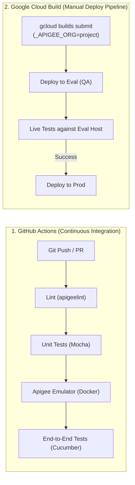

# CI/CD Pipeline & Cloud Deployment Architecture

This document describes the Continuous Integration and Continuous Deployment (CI/CD) strategy, pipeline workflows, and deployment automation for the `apigee-demos` repository.

---

## 1. CI/CD Architecture Overview

The repository adopts a two-tier strategy separating continuous validation from cloud deployment:



1. **GitHub Actions**: Continuous integration running on every commit and pull request. Validates syntax, style, unit transformations, and launches the Apigee Emulator inside Docker to run end-to-end integration tests without incurring Google Cloud costs or requiring production credentials.
2. **Google Cloud Build**: Cloud deployment pipeline triggered when changes are ready for GCP environments. Packages and deploys to the `eval` (QA) environment, validates against live traffic, and automatically promotes to `prod` upon passing tests.

---

## 2. GitHub Actions Workflow

Configuration file: [`.github/workflows/ci.yml`](.github/workflows/ci.yml)

### Triggers
* **Push**: All branches (`**`)
* **Pull Request**: Target branches `main` and `master`

### Pipeline Steps
1. **Repository Checkout**: Pulls the repository tree (`actions/checkout@v4`).
2. **Node.js Setup**: Prepares Node.js 18 runtime with caching (`actions/setup-node@v4`).
3. **Dependency Installation**: Runs `npm ci` (or `npm install`).
4. **Static Linting (`apigeelint`)**:
   ```bash
   npm run lint
   # executes ci/lint.sh
   ```
   Validates proxy configurations against Apigee X best practices.
5. **Unit Tests (Mocha)**:
   ```bash
   npm test
   ```
   Validates JavaScript transformation logic in isolation.
6. **Apigee Emulator Lifecycle**:
   * If a `GCP_SA_KEY` secret is provided in the repository, creates `cert/service-account.json`.
   * Starts the Apigee Emulator container in Docker:
     ```bash
     ./ci/apigee-emulator.sh start
     ```
   * Deploys the bundle and mock KVMs to the emulator's `dev` environment:
     ```bash
     ./ci/apigee-emulator.sh deploy dev
     ```
   * Verifies emulator status and deployed proxies:
     ```bash
     ./ci/apigee-emulator.sh status
     ```
7. **End-to-End Integration Tests (Cucumber / Apickli)**:
   ```bash
   export APIGEE_PROTO=http
   export APIGEE_HOST=localhost:8999/gcpreleases/v1
   # Full test suite if SA credentials exist, or offline mocks (echo, oas, errors)
   ```
8. **Emulator Teardown**:
   ```bash
   ./ci/apigee-emulator.sh stop
   ```
   Runs unconditionally (`if: always()`) to clean up container resources.

---

## 3. Google Cloud Build Deployment Pipeline

Configuration file: [`cloudbuild.yaml`](cloudbuild.yaml)

The Cloud Build pipeline orchestrates multi-environment promotion from evaluation/QA to production.

### Triggering the Pipeline

Submit a build directly via Google Cloud SDK:

```bash
gcloud builds submit \
  --substitutions=_APIGEE_ORG=your-gcp-project-id,_APIGEE_HOST=your-eval-ingress.sslip.io/eval/gcpreleases/v1
```

### Substitution Variables

| Variable | Default Value | Description |
|---|---|---|
| `_APIGEE_ORG` | `${PROJECT_ID}` | Target GCP Project ID / Apigee Organization. |
| `_APIGEE_HOST` | `apigee-34-171-124-235.sslip.io/eval/gcpreleases/v1` | Live ingress hostname used for post-eval integration tests. |
| `_CLOUD_SDK_VERSION` | `latest` | Container image tag for `gcr.io/google.com/cloudsdktool/google-cloud-cli`. |

### Execution Stages

1. **`install-node-deps` (`node:18`)**: Installs testing dependencies (`cucumber`, `apickli`, `mocha`).
2. **`run-unit-tests` (`node:18`)**: Runs Mocha unit tests on policy scripts.
3. **`deploy-to-eval` (`google-cloud-cli`)**:
   * Installs [`apigeecli`](https://github.com/apigee/apigeecli).
   * Generates a bundle and deploys the proxy to the `eval` environment using:
     ```bash
     make deploy ORG="${_APIGEE_ORG}"
     ```
4. **`run-integration-tests` (`node:18`)**:
   * Runs integration test scenarios against the live `eval` ingress:
     ```bash
     APIGEE_PROTO=https APIGEE_HOST="${_APIGEE_HOST}" npm run integration-test
     ```
5. **`deploy-to-prod` (`google-cloud-cli`)**:
   * Only executes if integration tests pass.
   * Promotes the already validated bundle to the `prod` environment:
     ```bash
     make deploy ENV=prod SKIP_BUNDLE_UPLOAD=true ORG="${_APIGEE_ORG}"
     ```

---

## 4. Local & Scripted Deployments

For manual or local deployments outside Cloud Build:

### Automated Deploy with `apigeecli`

```bash
# Provision service account and roles (BigQuery User, SA Token Creator)
make service-account

# Deploy to default eval environment
make deploy

# Deploy to prod environment
make deploy ENV=prod
```

### Clean Old Revisions

To avoid hitting Apigee revision limits, clean un-deployed old revisions:

```bash
make clean-revisions
```

---

## 5. Related Documentation

* [**`README.md`**](README.md): Project overview, prerequisites, and quickstart.
* [**`EMULATOR.md`**](EMULATOR.md): Apigee Emulator technical guide, REST API reference, and mock data setup.
* [**`AGENTS.md`**](AGENTS.md): Development best practices, linter verification, and coding standards for AI agents.

