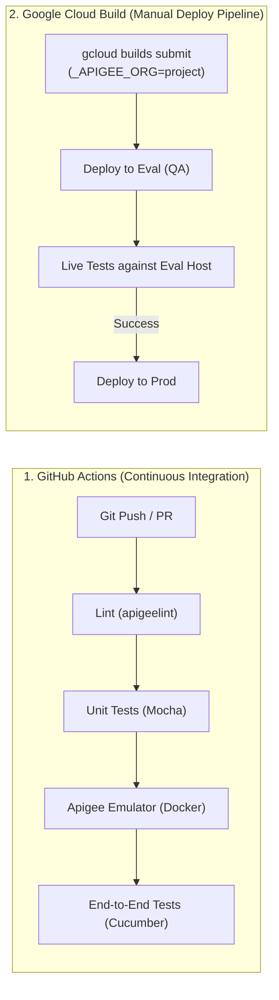

# apigee-demos

Apigee API Proxy demo (`gcpreleases-v1`) showcasing how to implement and monetize data-driven APIs on Google Cloud Apigee X / Hybrid using BigQuery.

This project was inspired by the Google Cloud video on **Monetizing Data with Apigee**:
* 🎥 [Inspiration: Monetizing Data with Apigee](https://www.youtube.com/watch?v=lUDZAzSpWEw)
* 🎥 [In-depth Walkthrough: Implementation Details](https://youtu.be/58smxQu3P5k)

The demo leverages BigQuery's synchronous query execution method (`jobs.query`) to query Google Cloud public release notes and return formatted API responses, showing how enterprises can securely expose and productize their data assets through Apigee.

This proxy demonstrates:
* **Dynamic Target Routing:** Generates the BigQuery API query URL dynamically using Apigee's built-in `{organization.name}` variable (which matches your Google Cloud Project ID), avoiding hardcoded project names across environments.
* **Google Authentication:** Configures `<GoogleAccessToken>` for secure, seamless IAM impersonation without static keys in production.
* **Response Transformation:** Transforms BigQuery tabular query responses into simplified JSON or XML objects via JavaScript and XML policies.
* **Environment Configuration:** Uses Key-Value Maps (KVM) for environment-specific parameters (e.g., `echoLimit`).
* **Local Emulator Support:** Ready for local development with Cloud Code / Apigee Emulator in Docker.

> [!WARNING]
> This proxy is intended for demonstration and learning purposes. In a production environment, ensure you apply appropriate security policies (OAuth/API Keys), Spike Arrest, Quotas, and caching!

---

## Prerequisites

Ensure the following tools are installed on your workstation:

* **Google Cloud SDK (`gcloud`):** Authenticated with permissions to manage Service Accounts and BigQuery (`gcloud auth login` and `gcloud auth application-default login`).
* **Node.js (v18+) and npm:** For unit tests, linter, and integration tests.
* **GNU `make`, `zip`, `unzip`, and `jq`:** Standard CLI build tools.
* **Docker:** Required for running the Apigee Emulator, Cloud Code local runtime, and Swagger UI.
* **[apigeecli](https://github.com/apigee/apigeecli) (Optional):** Required for automated deployments via `make deploy`. Install with:
  ```bash
  curl -L https://raw.githubusercontent.com/apigee/apigeecli/main/downloadLatest.sh | sh -
  export PATH=$PATH:$HOME/.apigeecli/bin
  ```

---

## Configuration & Project Selection

The provided [`Makefile`](Makefile) automatically resolves your active GCP project using:
1. `$ORG` or `make <target> ORG=...` (explicit CLI override)
2. `$GOOGLE_CLOUD_PROJECT` (if set)
3. `gcloud config get-value project` (active gcloud project)
4. `$PROJECT_ID` (environment variable, e.g. from CI/CD)
5. Default fallback: `training-gcp-demos`

You can explicitly override the target organization/project on any `make` command:
```bash
make <target> ORG=my-custom-project-id
```

### CI/CD Workflow Architecture

This repository uses a two-tier strategy separating continuous validation from cloud deployment:



1. **GitHub Actions ([`.github/workflows/ci.yml`](.github/workflows/ci.yml))**:
   - Runs on every `push` and `pull_request`.
   - Executes linting, unit tests, and launches the **Apigee Emulator in Docker** to run end-to-end Cucumber integration tests locally without incurring GCP cloud costs or needing production credentials.

2. **Cloud Build Deployment Pipeline ([`cloudbuild.yaml`](cloudbuild.yaml))**:
   - Manually triggered when you are ready to validate and deploy to GCP cloud environments:
     ```bash
     gcloud builds submit \
       --substitutions=_APIGEE_ORG=your-monthly-project-id,_APIGEE_HOST=your-eval-ingress.sslip.io/eval/gcpreleases/v1
     ```
   - Uses the following substitution variables:

| Variable | Default Value | Description |
|---|---|---|
| `_APIGEE_ORG` | `${PROJECT_ID}` | Target GCP Project ID / Apigee Organization for deployment. |
| `_APIGEE_HOST` | `apigee-34-171-124-235.sslip.io/eval/gcpreleases/v1` | Live ingress hostname used for post-eval integration tests. |
| `_CLOUD_SDK_VERSION` | `latest` | Container image tag for `gcr.io/google.com/cloudsdktool/google-cloud-cli`. |

---

## Local Development & Testing

### 1. One-Step Local Setup

To prepare your local environment for Cloud Code / Apigee Emulator, run:

```bash
make setup-local
```

This target:
1. Generates `src/main/apigee/environments/dev/deployments.json` from the template, configuring your project's service account.
2. Checks if `./cert/service-account.json` exists; if not, it automatically provisions the GCP Service Account with `roles/bigquery.user` and `roles/iam.serviceAccountTokenCreator`, and downloads the key to `./cert/` (which is kept out of Git via `.gitignore`).

### 2. Local Emulator CLI & Deployment

You can run the Apigee Emulator in Docker and deploy proxies locally using the provided CLI or Makefile targets:

```bash
# Start emulator (if not running) and deploy the local proxy + test mocks
make emulator-deploy

# Check emulator version and deployed proxies
make emulator-status

# Test the deployed proxy endpoints locally
make emulator-test
```

Alternatively, manage the emulator directly with the standalone CLI:

```bash
# Start and wait for healthy state
./ci/apigee-emulator.sh start

# Deploy to 'dev' environment
./ci/apigee-emulator.sh deploy dev

# Test endpoints
./ci/apigee-emulator.sh test /gcpreleases/v1/echo
./ci/apigee-emulator.sh test /gcpreleases/v1/releases

# Stop emulator container
./ci/apigee-emulator.sh stop
```

For complete technical documentation on the emulator architecture, endpoints (`/v1/emulator/*`), and CI/CD integration, refer to [**`EMULATOR.md`**](EMULATOR.md).

### 3. Linting & Static Analysis

Validate the API Proxy bundle against Apigee X best practices using `apigeelint`:

```bash
./ci/lint.sh
```

### 4. Unit Tests

Run unit tests for JavaScript business logic (isolated transformation of BigQuery rows):

```bash
npm test
```

### 5. Running Integration Tests (BDD / Apickli)

If you have the Apigee Emulator running locally on port 8998:

```bash
npm run integration-test
```

Or run the complete pre-commit check (detects emulator container, runs linter, unit tests, and integration tests):

```bash
./ci/pre-commit-checks.sh
```

### 6. Local OpenAPI / Swagger Preview

To preview the API specification in a local Swagger UI container:

```bash
make swagger-ui
```
Open your browser at `http://localhost:8999`.

---

## Cloud Deployment (Apigee X / Hybrid)

### Option A: Automated Deploy via `apigeecli` (Recommended)

1. Provision the Service Account and IAM roles in Google Cloud:
   ```bash
   make service-account
   ```
2. Deploy the proxy bundle to your environment (`eval` by default):
   ```bash
   make deploy
   ```
   To deploy to a specific environment (e.g., `prod`):
   ```bash
   make deploy ENV=prod
   ```

### Option B: Manual Bundle Upload via Apigee Console

1. Create a deployable `.zip` bundle:
   ```bash
   make bundle
   ```
   The bundle will be generated under `target/bundles/gcpreleases-v1_<timestamp>.zip`.
2. In the Google Cloud Console, navigate to **Apigee > Proxies > Upload Proxy Bundle**.
3. Deploy the proxy to your environment using the service account `apigee-demos@<PROJECT_ID>.iam.gserviceaccount.com`.

> [!NOTE]
> Unlike older versions of this demo, you **do not** need to edit the BigQuery target endpoint URL manually. The proxy automatically uses `{organization.name}` to route queries to your Google Cloud Project!

---

## Verifying the Deployment

### From an internal Test VM or peered VPC:

```bash
export AUTH="Authorization: Bearer $(gcloud auth print-access-token)"
export PROJECT_ID="$(gcloud config get project)"
export ENV_GROUP_HOSTNAME=$(curl -s -H "$AUTH" https://apigee.googleapis.com/v1/organizations/$PROJECT_ID/envgroups | jq -r '.environmentGroups[0].hostnames[0]')

# Test the mock echo endpoint
curl -k https://${ENV_GROUP_HOSTNAME}/gcpreleases/v1/echo | jq .

# Query recent Google Cloud release notes from BigQuery
curl -k https://${ENV_GROUP_HOSTNAME}/gcpreleases/v1/releases | jq .

# Limit results and request XML format
curl -k -H "Accept: application/xml" "https://${ENV_GROUP_HOSTNAME}/gcpreleases/v1/releases?limit=3"
```

---

## References

* [Video: Monetizing Data with Apigee (Inspiration)](https://www.youtube.com/watch?v=lUDZAzSpWEw)
* [Video: In-depth Walkthrough & Implementation Details](https://youtu.be/58smxQu3P5k)
* [Apigee: Using Google Authentication](https://cloud.google.com/apigee/docs/api-platform/security/google-auth/overview)
* [Apigee Emulator Local Development](https://cloud.google.com/apigee/docs/api-platform/local-development/vscode/overview)
* [BDD Proxy Development with Apigee](https://github.com/apigee/devrel/blob/main/labs/bdd-proxy-development/lab.md)
* [BigQuery Public Datasets: Google Cloud Release Notes](https://console.cloud.google.com/marketplace/product/bigquery-public-data/google-cloud-release-notes)
